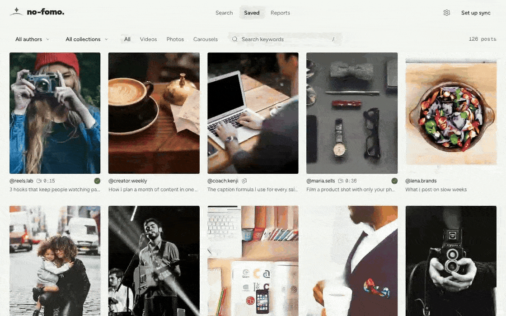
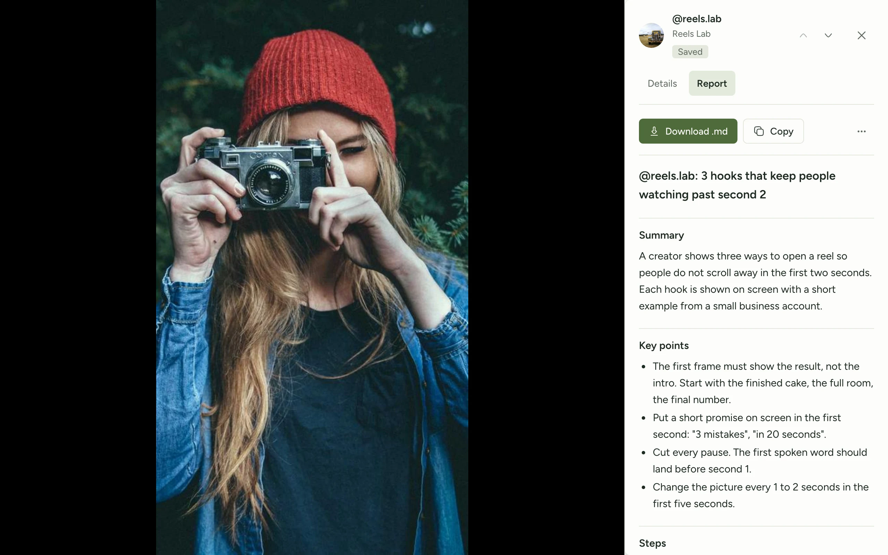
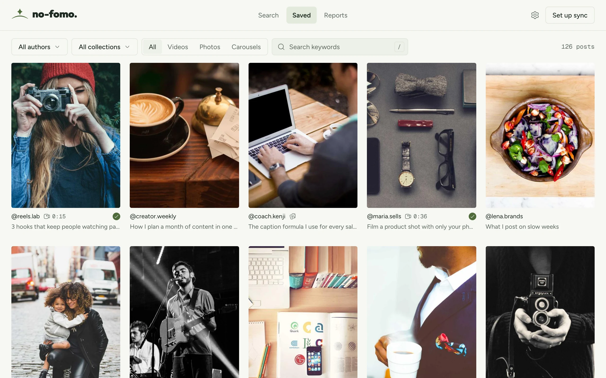

<p align="center">
  
</p>

<h3 align="center">Keep up with everything you save.</h3>

<p align="center">
  You save reels faster than you can watch them. no-fomo-social watches them for you and turns each one into notes, steps and ideas you can use.<br>
  Free, open source, and it runs on your computer.
</p>

<p align="center">
  <a href="#install"><b>Install</b></a> ·
  <a href="#what-it-does">What it does</a> ·
  <a href="#privacy-and-safety">Privacy</a> ·
  <a href="#questions">Questions</a> ·
  <a href="CONTRIBUTING.md">Contribute</a>
</p>

<p align="center">
  <a href="https://github.com/no-fomo-org/no-fomo-social/releases/latest"></a>
  <a href="https://github.com/no-fomo-org/no-fomo-social/actions/workflows/ci.yml"></a>
  <a href="LICENSE"></a>
  
</p>

<p align="center">
  
</p>

## Install

You need a Mac (macOS 11 or newer) or a Windows 10/11 computer, and Google Chrome. No other software.

**1. Paste one line.**

On a **Mac**, open Terminal (press <kbd>Cmd</kbd> + <kbd>Space</kbd>, type *Terminal*, press <kbd>Enter</kbd>) and paste:

```bash
curl -fsSL https://raw.githubusercontent.com/no-fomo-org/no-fomo-social/main/scripts/install/install.sh | bash
```

On **Windows**, open PowerShell (press the Windows key, type *PowerShell*, press <kbd>Enter</kbd>) and paste:

```powershell
irm https://raw.githubusercontent.com/no-fomo-org/no-fomo-social/main/scripts/install/install.ps1 | iex
```

**2. Add the [no-fomo-social extension](https://chromewebstore.google.com/detail/EXTENSION_STORE_ID) to Chrome.**

**3. Log in to instagram.com in Chrome, then press Sync in no-fomo-social.**

no-fomo-social opens at `http://localhost:4747`. Next time, open it from Launchpad or Spotlight (Mac) or the Start Menu (Windows). To make reports, add your OpenAI key under the gear icon. Each report usually costs a few cents.

<details>
<summary>Update, remove, and what the installer does</summary>

- **Update:** run the same line again.
- **Remove:** run `no-fomo-social uninstall`. Your library in `~/.no-fomo-social` stays until you delete that folder.
- The installer downloads the latest [release](https://github.com/no-fomo-org/no-fomo-social/releases), checks its SHA-256 checksum, and puts the app in `~/.no-fomo-social/app`. The app brings its own Node.js and ffmpeg, so nothing else is installed on your computer. Read the scripts: [install.sh](scripts/install/install.sh), [install.ps1](scripts/install/install.ps1).

</details>

## What it does

<picture>
  <source media="(prefers-color-scheme: dark)" srcset=".github/assets/viewer-report-dark.webp">
  
</picture>

**A report on any reel.** Summary, key points, steps, everything shown on screen, and the full transcript, built from the video's frames and audio. Download it as Markdown and take it to ChatGPT, Claude or your notes. Reports work in about 45 languages.

**Study any account.** Open a creator or a competitor, see their posts, and get reports on the ones that matter. Learn what they teach without watching for hours.

<picture>
  <source media="(prefers-color-scheme: dark)" srcset=".github/assets/saved-dark.webp">
  
</picture>

**Your saved posts, in order.** Everything you saved on Instagram in one grid, with filters by author, collection and type, search that also finds words inside reports, and a real video player with keyboard controls.

**Made for people who make content:** business owners, bloggers, coaches, experts and marketers who want to learn from the best of Instagram, faster.

<sub>Screenshots use made-up demo accounts and posts.</sub>

### Coming next

- **Virality analysis:** which reels did far better than the account's usual, and what they have in common.
- **Hook analysis:** the first seconds of many reels side by side.

## Privacy and safety

- **Your data stays on your computer.** The library lives in `~/.no-fomo-social`. There is no no-fomo-social server that sees your posts, reports or account.
- **You bring the AI key.** Your OpenAI key is stored encrypted on your computer and sent only to OpenAI.
- **Careful with Instagram.** no-fomo-social uses your own Instagram login, the same way the website does. It makes one request at a time, at most 150 an hour, and stops for 15 minutes, then 1 hour, then 6 hours if Instagram refuses. Every request is logged on your computer.

> [!WARNING]
> no-fomo-social uses Instagram's private web API, not an official one. It is slow on purpose to keep your account safe, but there is still a small risk. Use it at your own risk.

## Questions

<details>
<summary><b>Is it free?</b></summary>

Yes. The app is free and open source under the MIT license. You only pay OpenAI for reports, usually a few cents each.
</details>

<details>
<summary><b>Do I need to know how to code?</b></summary>

No. You paste one line, and the installer does the rest. After that, no-fomo-social opens like any other app.
</details>

<details>
<summary><b>Does it download videos?</b></summary>

No. Videos play straight from Instagram. To make a report, a video is downloaded to a temporary folder, analyzed, and deleted right after.
</details>

<details>
<summary><b>How do I find posts I unsaved on Instagram?</b></summary>

Open the menu next to Sync and pick <b>Full resync</b>. It checks every saved post (about 2 minutes per 1,000 posts) and hides the ones that are gone. If more than 30% seem gone, nothing is hidden, because that usually means an Instagram glitch.
</details>

<details>
<summary><b>Keyboard shortcuts?</b></summary>

Up and Down: previous or next post. Esc: close. Video: Space play or pause, Left and Right seek 5 seconds, <code>,</code> and <code>.</code> step one frame, M mute, F fullscreen. Carousel: Left and Right move between items.
</details>

<details>
<summary><b>Where can I see what no-fomo-social sent to Instagram?</b></summary>

Every call is logged on your computer:

```bash
sqlite3 ~/.no-fomo-social/no-fomo-social.db "select datetime(at/1000,'unixepoch','localtime'), kind, status, result from ig_calls order by id desc limit 50"
```
</details>

## Contributing

The website lives in its own repo: [no-fomo-website](https://github.com/no-fomo-org/no-fomo-website).

Bug reports, ideas and pull requests are welcome. See [CONTRIBUTING.md](CONTRIBUTING.md) to run no-fomo-social from source, and [SECURITY.md](SECURITY.md) to report a security problem privately.

## License

[MIT](LICENSE) for the code. The no-fomo name, logo and brand photographs are not covered by the MIT license; please do not use them for other products.

no-fomo-social is not affiliated with Instagram or Meta. Instagram is a trademark of Meta Platforms, Inc.
